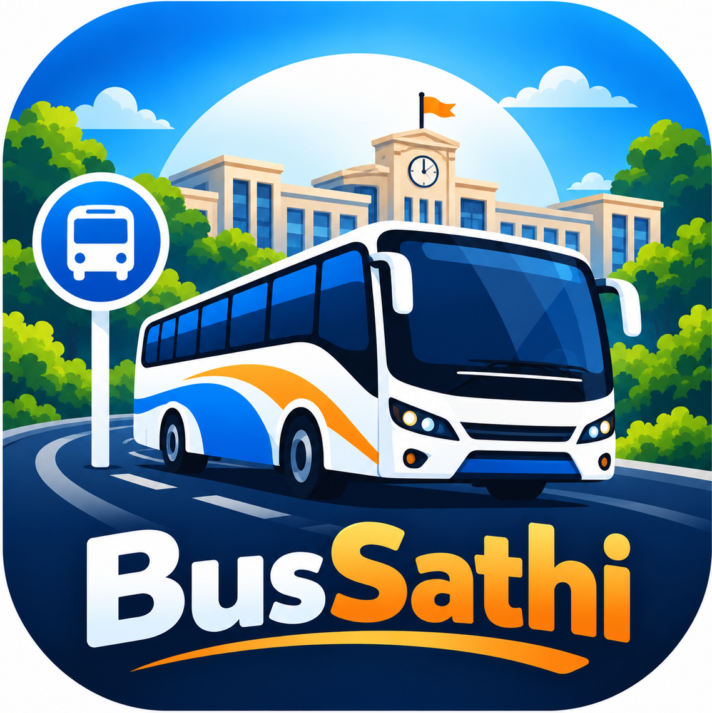

# 🚌 BusSathi — College Bus Route & Schedule Assistant

<div align="center">



### *Smart, Real-Time Campus Transit Companion*
**College ↔ Kathora Route Management System**

[](https://developer.android.com/)
[](https://www.oracle.com/java/)
[-blue?style=for-the-badge)](https://developer.android.com/)
[](https://developer.android.com/)
[](https://firebase.google.com/)
[](https://m3.material.io/)

</div>

---

## 📖 Overview

**BusSathi** is an Android mobile application engineered to streamline daily bus transit for students, staff, and transport coordinators along the **College ↔ Kathora** corridor.

The application eliminates guesswork by providing precise timing lookups, voice-guided schedule announcements, dynamic bidirectional route tracking, and custom stop bookmarks. For transport managers, BusSathi includes an administrative panel capable of modifying stops, updating shift timings, and synchronizing schedule changes in real time across devices using **Cloud Firestore** and **SQLite**.

---

## ✨ Key Features

### 🎓 Student & Passenger Features
* **🕒 Bus Schedule & Shift Lookups**:
  * Select between **Bus 1** and **Bus 2** across **Morning** and **Evening** shifts.
  * Pick travel direction (*College → Kathora* or *Kathora → College*) and any stop to get arrival and departure times.
* **🔊 Voice Announcements (Text-to-Speech)**:
  * Integrated Android Text-to-Speech (`TextToSpeech` engine) reads schedules aloud with one tap.
* **🗺️ Integrated Map Directions**:
  * Launch external map apps directly via implicit intents (`geo:` URI) to inspect route topography.
* **📍 Dynamic Route & Stops Explorer**:
  * Visual route timeline with direction indicators (`↓`).
  * Live stop search and dynamic filtering via `TextWatcher`.
  * Dynamically reversed return route view.
* **⭐ "My Stop" Personalization**:
  * Bookmark your daily boarding stop using Android `SharedPreferences`.
  * Instant home screen card with next bus arrival without repetitive searches.

### 🛡️ Administrative Portal
* **🔐 Secure Authentication**:
  * Credentials-protected portal for transport administrators (`admin` / `admin123`).
* **🛑 Stop Management (Full CRUD)**:
  * Add new stops, modify stop names, or reorder/delete existing stops.
* **⏱️ Schedule & Timing Management**:
  * Update arrival and departure timestamps per stop, bus, direction, and shift period.
* **📊 Master Timetable View**:
  * Consolidated tabular view of forward and return schedules.

---

## ⚡ Architecture & Dual-Database Sync

BusSathi is built using an **Offline-First, Cloud-Synced Architecture**:

```
                  ┌────────────────────────────────────────┐
                  │           BusSathi UI Layer            │
                  │ (MainActivity, BusSchedule, Route, etc)│
                  └───────────────────┬────────────────────┘
                                      │
                   ┌──────────────────┴──────────────────┐
                   ▼                                     ▼
      ┌─────────────────────────┐           ┌─────────────────────────┐
      │   FirestoreRepository   │           │     DatabaseHelper      │
      │    (Cloud Firestore)    │           │     (Local SQLite)      │
      └────────────┬────────────┘           └────────────┬────────────┘
                   │                                     │
           [Online Realtime]                      [Offline Fallback]
                   │                                     │
                   ▼                                     ▼
        Google Firebase Cloud                Local Device Storage (.db)
                   ▲                                     ▲
                   └───────────────┬─────────────────────┘
                                   │
                      Auto-seeded on First Run
                      (assets/bus_route.json)
```

1. **Cloud Firestore (Primary Cloud)**:
   * Real-time listeners (`ListenerRegistration`) push instant updates when an admin alters a timing.
2. **SQLite Database (Local Engine)**:
   * Provides full zero-network offline functionality.
   * Seamless automated fallback if internet is unavailable or Firebase is not configured.
3. **Automated Asset Seeding**:
   * Reads default stops and timetable from `app/src/main/assets/bus_route.json` on initial app launch.

---

## 🗄️ Database Schemas

### SQLite Tables (`CampusBus.db`)
* **`admins`**: `id`, `username`, `password`
* **`stops`**: `id`, `stop_name`, `stop_order`
* **`periods`**: `id`, `name`, `start_time`, `end_time`
* **`schedules`**: `id`, `bus_number`, `schedule_period_id`, `stop_id`, `direction`, `arrival_time`, `departure_time`

### Cloud Firestore Collections
* `stops`: `{ stopName, stopOrder }`
* `periods`: `{ name, startTime, endTime }`
* `schedules`: `{ busNumber, schedulePeriodId, stopId, direction, arrivalTime, departureTime }`

> **Default Admin Credentials**:
> * **Username**: `admin`
> * **Password**: `admin123`

---

## 🛠️ Tech Stack & Android Concepts

| Category | Technology / API |
| :--- | :--- |
| **Language** | Java (JDK 11) |
| **Build System** | Gradle (Kotlin DSL `build.gradle.kts` + Version Catalogs) |
| **Architecture** | MVC / Repository Pattern (`FirestoreRepository`, `DatabaseHelper`) |
| **UI Components** | Material Components 3, `ConstraintLayout`, `EdgeToEdge`, Custom `BaseAdapter` |
| **Local Storage** | SQLite (`SQLiteOpenHelper`) & `SharedPreferences` |
| **Cloud Backend** | Google Firebase Cloud Firestore (`firebase-bom:33.7.0`) |
| **Hardware / OS APIs**| Android Text-to-Speech (`android.speech.tts.TextToSpeech`), Implicit Geo Intents |

### 📚 Academic / Curriculum Alignment (MAD Syllabus)
* **Unit 2 & 4**: Complete Activity Lifecycle management (`onCreate`, `onStart`, `onResume`, `onPause`, `onDestroy`), Explicit & Implicit Intents.
* **Unit 3**: Advanced XML UI layouts, Material theme styling, custom adapter lists, input validation.
* **Unit 5**: Mobile Database management (SQLite CRUD operations & Firebase Cloud Firestore integration).
* **Unit 6**: JSON Asset Parsing, Hardware TTS API, Map URI schema, and SharedPreferences.

---

## 📂 Project Structure

```text
BusSathi/
├── app/
│   ├── build.gradle.kts
│   └── src/main/
│       ├── AndroidManifest.xml
│       ├── assets/
│       │   └── bus_route.json             # Seed route data & schedules
│       ├── java/com/example/bussathi/
│       │   ├── MainActivity.java          # Dashboard / Launchpad
│       │   ├── BusScheduleActivity.java   # Timings query & TTS audio
│       │   ├── RouteActivity.java         # Route stops timeline & search
│       │   ├── MyStopActivity.java        # Personalized saved stop
│       │   ├── AdminLoginActivity.java    # Admin login verification
│       │   ├── AdminActivity.java         # Admin dashboard
│       │   ├── StopListActivity.java      # Stops management view
│       │   ├── StopFormActivity.java      # Add / Edit stop form
│       │   ├── ManageTimingsActivity.java # Set bus arrival/departure
│       │   ├── ViewTimetableActivity.java # Master timetable viewer
│       │   ├── DatabaseHelper.java        # Local SQLite database manager
│       │   ├── FirestoreRepository.java   # Firebase Firestore repository
│       │   └── JsonImporter.java          # Asset JSON loader
│       └── res/
│           ├── layout/                    # XML activity & item layouts
│           ├── drawable/                  # Vector drawables & brand logos
│           └── values/                    # Colors, styles, strings
├── gradle/
│   └── libs.versions.toml                 # Version catalog
└── build.gradle.kts                       # Root build configuration
```

---

## 🚀 Getting Started

### Prerequisites
* **Android Studio**: Koala / Ladybug or newer.
* **JDK**: Version 11 or higher.
* **Device / Emulator**: Android 7.0 (API level 24) or above.

### Installation Steps

1. **Clone the repository**:
   ```bash
   git clone https://github.com/PranayChandurkar/bus-sathi
   cd BusSathi
   ```

2. **Open in Android Studio**:
   * Launch Android Studio.
   * Select **Open** and select the `BusSathi` directory.
   * Let Gradle sync dependencies.

3. **(Optional) Firebase Setup**:
   * BusSathi works **100% offline out-of-the-box** using SQLite and `bus_route.json`.
   * To enable real-time cloud sync:
     1. Create a project in [Firebase Console](https://console.firebase.google.com/).
     2. Add an Android app with package name: `com.example.bussathi`.
     3. Download `google-services.json` and place it in the `app/` directory.
     4. Enable **Cloud Firestore** in test or production mode.

4. **Run the Project**:
   * Connect an Android device with USB Debugging enabled, or start an AVD emulator.
   * Click **Run (Shift + F10)**.

---


## 👥 Contributors & Acknowledgements

* **Developed by**: Pranay & Team
* Built as an academic project demonstrating Mobile Application Development (MAD) fundamentals.

---

## 📄 License

This project is licensed under the [MIT License](LICENSE) — free for educational, academic, and non-commercial development.
